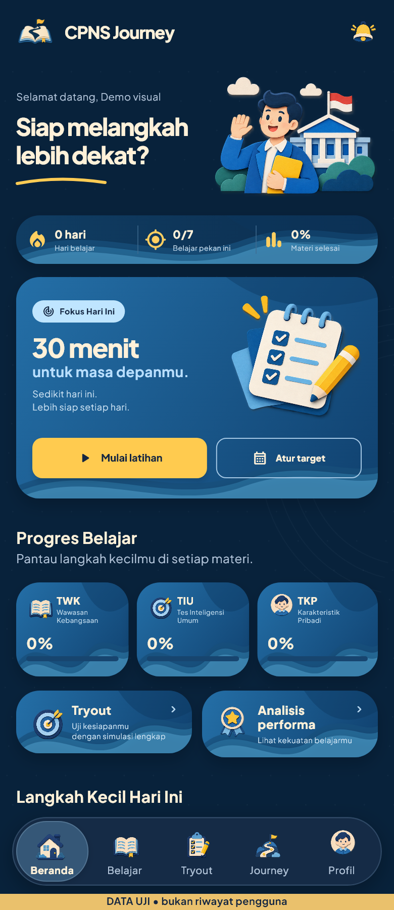
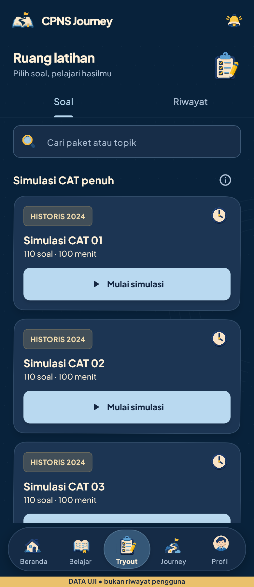
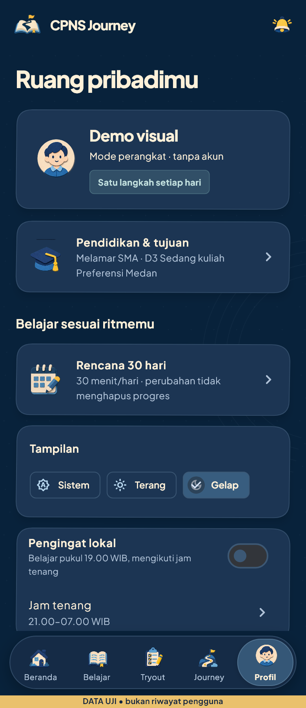
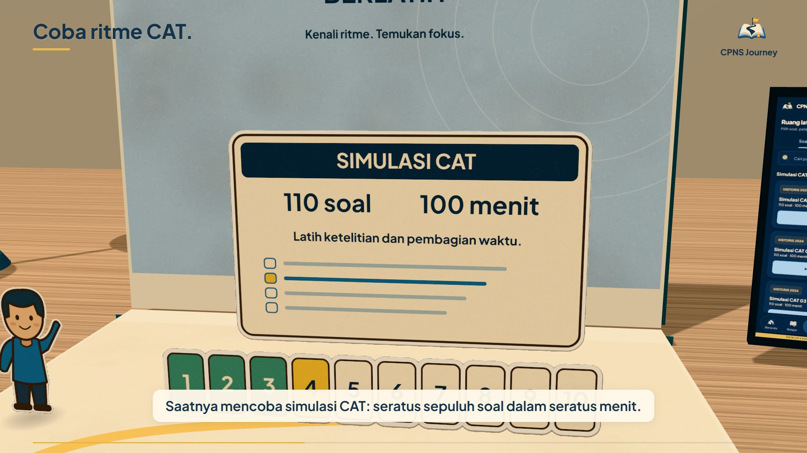

<div align="center">
  
  <h1>CPNS Journey</h1>
  <p><strong>Langkah kecil setiap hari. Persiapan yang lebih terarah.</strong></p>
  <p>Belajar, latihan CAT, dan pantau perjalanan seleksi dalam satu aplikasi Android<br/>dengan desain papercut, tema dark blue, dan penyimpanan di perangkat.</p>
  <p>
    
    
    
  </p>
  <p>
    <a href="https://github.com/Asirakun/cpns_apk/releases/tag/v1.2.3"><strong>Unduh APK</strong></a> ·
    <a href="#preview-aplikasi">Preview aplikasi</a> ·
    <a href="#demo-video">Demo video</a> ·
    <a href="docs/LANJUTKAN_DI_CODEX.md">Panduan pengembangan</a>
  </p>
</div>

## Preview aplikasi

<table>
  <tr><th>Beranda</th><th>Tryout</th><th>Profil</th></tr>
  <tr>
    <td></td>
    <td></td>
    <td></td>
  </tr>
</table>

Screenshot dirender dari antarmuka Flutter dengan **data uji**, bukan riwayat pengguna. Versi 1.2.3 mempertahankan ikon papercut, menambahkan navbar kapsul mengambang, serta memakai intro dengan SFX dan latar aplikasi.

## Demo video

[](https://github.com/Asirakun/cpns_apk/releases/download/v1.2.3/CPNS_JOURNEY_REMOTION_1080p60.mp4)

**[Buka / unduh video 1080p60](https://github.com/Asirakun/cpns_apk/releases/download/v1.2.3/CPNS_JOURNEY_REMOTION_1080p60.mp4)** · [Subtitle Indonesia](https://github.com/Asirakun/cpns_apk/releases/download/v1.2.3/CPNS_JOURNEY_REMOTION_ID.srt) · [Source dan panduan render](video-demo/README.md)

Demo Remotion berdurasi sekitar **2 menit**, dengan narasi Indonesia dan animasi buku pop-up. Klik gambar untuk membuka MP4; browser dapat memutar atau mengunduhnya. Video merupakan presentasi fitur. Preview tampilan aplikasi sebenarnya ada pada galeri di atas. Master video sekitar 236 MiB, disimpan sebagai aset Release agar tidak membebani riwayat Git.

## Yang bisa kamu lakukan

| Ruang | Fitur |
| --- | --- |
| **Beranda** | Fokus harian, progres TWK/TIU/TKP, prioritas dan grafik latihan. |
| **Belajar** | Materi offline, pencarian, bookmark dan pengulangan topik. |
| **Tryout** | Simulasi CAT, latihan singkat, autosave, review jawaban dan riwayat dengan filter. |
| **Journey** | Tahap S00–S11, berkas, agenda WIB, persiapan SKB dan anggaran. |
| **Analisis** | Ringkasan harian, mingguan dan bulanan dari aktivitas belajar. |
| **Profil** | Tema, target belajar, pengingat, ekspor PDF/CSV/JSON dan pengaturan akun. |

Mode perangkat dapat dipakai tanpa akun. Sinkronisasi akun memerlukan konfigurasi Supabase milik pemilik aplikasi; data perangkat dan akun mempunyai namespace terpisah.

## Mulai menggunakan

1. Unduh **[APK 1.2.3 ARM64](https://github.com/Asirakun/cpns_apk/releases/download/v1.2.3/cpns-journey-1.2.3-arm64-v8a.apk)** untuk Android 7.0 atau lebih baru.
2. Pasang aplikasi, isi nama panggilan, lalu pilih **Mulai di perangkat**.
3. Atur target harian, pelajari materi, dan coba latihan pertama.

Untuk pembaruan, gunakan APK dengan tanda tangan release yang sama. Ekspor progres sebelum tindakan yang menghapus data. Intro dapat diputar ulang dari **Profil → Intro CPNS Journey**.

## Verifikasi rilis

Build 1.2.3: **70 tes Flutter**, **33 pemeriksaan SQL**, **42 pemeriksaan APK**, dan **118 pemeriksaan aset** lulus. Android Lint: 0 error, 7 warning. Ini adalah hasil pemeriksaan build, bukan jaminan bebas risiko; uji audio/focus pada HP fisik dan Supabase hosted belum dilakukan.

[Perubahan dan screenshot](docs/NAVBAR_V1_2_3.md) · [Laporan keamanan](docs/KEAMANAN.md) · [Hasil pengujian](docs/VERIFIKASI.md) · [Intro dengan SFX](docs/INTRO_SFX_V1_2_2.md)

**Aplikasi independen, bukan produk BKN/Kemenkeu.** Soal latihan original berbasis template belum ditinjau ahli satu per satu. Nilai latihan dan preset historis bukan hasil seleksi resmi atau jaminan kelulusan.

## Mengembangkan aplikasi

```sh
flutter pub get --enforce-lockfile
flutter analyze
flutter test
```

Build terverifikasi memakai Flutter 3.50.1 / Dart 3.14.0, JDK 21 dan Android SDK 36. [Panduan Windows drive D](docs/LANJUTKAN_DI_CODEX.md) memuat konfigurasi lengkap. Terapkan migrasi tambahan ke database existing sesuai riwayatnya; jangan membuat ulang database untuk upgrade.

<details>
<summary><strong>Dokumentasi teknis lengkap: instalasi, Supabase, build dan batas konten</strong></summary>

## Menjalankan aplikasi dan status APK

**Status 21 November 2026:** versi 1.2.3 memakai navbar kapsul mengambang dengan lima ikon lama. Intro cpns-intro dengan SFX, latar aplikasi dan tanpa tombol Lewati ikut dalam APK. Data, fitur dan kunci release existing dipertahankan. [APK](https://github.com/Asirakun/cpns_apk/releases/download/v1.2.3/cpns-journey-1.2.3-arm64-v8a.apk), [laporan file/tes](docs/NAVBAR_V1_2_3.md), [screenshot](docs/design/screenshots/v1.2.3/home.png). 70 tes Flutter/33 SQL/42 APK/118 aset lulus. Uji audio HP fisik belum dilakukan.

Untuk memasang APK release:

1. Pasang APK pada Android 7.0+ **ARM64**. Izinkan instalasi dari sumber yang kamu pilih saat Android meminta.
2. Buka aplikasi, isi nama panggilan, lalu **Mulai di perangkat**. Materi, CAT dan checklist bisa digunakan tanpa akun/internet.
3. Untuk cloud, hubungkan proyek Supabase existing milikmu, jalankan SQL di bawah, lalu Profil → Akun → masukkan Project URL dan publishable/anon key. Jangan masukkan secret/service_role key.

Jika APK debug sebelumnya sudah terpasang, identitas penandatangan berbeda dan Android dapat menolak update. Jangan menghapus aplikasi/data sebelum mengekspor progres dan memastikan cara pemulihannya; UI impor JSON belum tersedia. Pemeriksaan ini tidak menghapus data perangkat.

Konfigurasi signed release telah disiapkan; simpan kunci rilis milikmu di tempat privat agar pembaruan berikutnya memakai tanda tangan yang sama. Source tidak menyertakan private key. Mode perangkat dan mode akun sengaja mempunyai namespace terpisah; progres tamu tidak otomatis dipindah ke akun. Ekspor sebelum beralih atau menghapus data.

## Flutter di drive D (Windows)

Lokasi yang digunakan: `D:\Development\flutter`, SDK pada `D:\Development\Android\Sdk`, cache Pub/Gradle pada `D:\Development\cache`. Proyek dapat diekstrak ke `D:\Projects\CPNSJourney`.

Jalankan PowerShell dari folder proyek:

```powershell
.\scripts\setup_windows_d.ps1
# Setelah JDK 21 tersedia; skrip menampilkan persetujuan lisensi SDK:
.\scripts\setup_windows_d.ps1 -InstallAndroidSdk
```

Skrip memerlukan Git, akses internet dan drive D. Tidak mengubah HOME/USERPROFILE, tidak menghapus instalasi Flutter lama pada C, dan tidak perlu hak administrator. Telemetri Flutter dinonaktifkan dan cache analyzer diarahkan ke D. Skrip Windows disediakan untuk dijalankan pada komputer Windows; build 1.2.3 telah diverifikasi pada Windows dengan SDK dan cache di drive D.

```powershell
flutter doctor
flutter pub get
flutter run
flutter analyze
flutter test
```

Versi build: Flutter 3.50.1 / Dart 3.14.0, JDK 21, compile/target SDK 36, minimum SDK 24 (Android 7.0), mengikuti minimum yang didukung Flutter ini. Material UI dipakai melalui paket resmi `material_ui` karena Flutter 3.50 telah memindahkan library Material dari impor lama. Dependency `image` dipin 4.5.4 untuk kompatibilitas dengan `archive` yang tersedia; lockfile disertakan.

## Supabase

1. Gunakan proyek Supabase existing milikmu. Paket/kuota/pausing mengikuti ketentuan Supabase.
2. Gunakan proyek Supabase existing. Terapkan hanya migrasi yang belum terpasang sesuai urutan: initial, optional private storage, security hardening, lalu `202611210001_analytics_additive.sql`. Jika 001–003 sudah terpasang, cukup migration analitik baru. Jangan membuat ulang database atau menjalankan seed ulang untuk upgrade. Supabase CLI dapat dipakai dengan riwayat migration yang sesuai.
3. Migration kedua berisi bucket **private** untuk pengembangan unggah di masa depan; UI v1 tetap metadata-only. Tidak ada kebutuhan mengunggah KTP/KK.
4. Aktifkan email/password dan email confirmation. Tambahkan `id.cpnsjourney://login-callback` pada Auth → URL Configuration → Redirect URLs, dan konfigurasi email/SMTP untuk verifikasi/reset sesuai layananmu.
5. Hubungkan Project URL dan **publishable/anon** key dari aplikasi. Alternatif build: `--dart-define-from-file=.env.json` dengan objek JSON public settings. Jangan menyimpan secret/service-role key dalam source/APK.
6. Untuk pembaruan paket, unggah JSON berversi (format sama dengan assets/content/content.json) ke bucket konten publik terpisah seperti `content-packages`, lalu isi `download_url`, `content_hash` SHA-256, `size_bytes`, `reviewer` dan `publication_status=published` pada content_releases. Jangan gunakan bucket dokumen pribadi.
7. Untuk konten resmi, kurasi melalui Studio. Set `publication_status=published` hanya setelah tinjauan. Formasi harus merujuk sumber HTTPS resmi dengan `status=verified` dan `verified_at`. Tidak ada formasi/deadline 2026 fiktif pada seed.

RLS aktif pada 27 tabel public. Master hanya dapat dibaca jika published; penulisan user dilakukan lewat RPC `sync_user_state` yang mengambil identitas dari JWT, menggunakan lock/version, UUID operation id dan transaksi. Snapshot adalah sumber sinkronisasi utama; profil, attempt/jawaban, dokumen, tahap dan progres juga diproyeksikan ke tabel terstruktur. Kolom/tabel lain disiapkan untuk pengembangan; bukan semua diisi sebagai data terpisah oleh UI saat ini.

SQLite/Drift menyimpan snapshot per namespace dan outbox atomik di Android. Payload snapshot dienkripsi AES-256-GCM menggunakan kunci acak melalui secure storage; metadata namespace/outbox tetap terbuka. Jawaban dan deadline disimpan setelah tiap perubahan. Retry menggunakan backoff; UI menyatakan **tersimpan di HP** sampai cloud mengonfirmasi. Konflik versi meminta pemilihan data. Memilih perangkat tidak boleh mengubah attempt cloud yang sudah submitted; jika riwayat berbeda, gunakan data cloud atau backup lengkap. Logout menghapus cache akun di perangkat setelah konfirmasi. Hapus akun memanggil RPC dan cascade ke seluruh data miliknya.

## Fitur yang tersedia

- Lima tab: Beranda, Belajar, Tryout, Journey, Profil; terang/gelap/sistem; font lokal Plus Jakarta Sans; layout ponsel/tablet.
- Onboarding, profil SMA/D3/Medan, autentikasi email, reset password, mode perangkat.
- 12 materi, pencarian/filter, bookmark, progres; prioritas topik dari kesalahan dan kartu pengulangan 1/3/7 hari.
- 450 soal original berbasis template, 3 paket CAT penuh non-overlap (30 TWK + 35 TIU + 45 TKP, 100 menit), latihan singkat/topik, timer persisten, navigator, ragu-ragu, autosave, submit satu kali dan review.
- Skor deterministik, grafik dari riwayat aktual; semua ambang/preset 2024 diberi label historis. Tidak ada klaim lulus resmi.
- Tracker S00–S11, status/evidence pribadi, arsip cycle, formasi dan sumber berkatalog, peringatan pendidikan dan penempatan, SKB bersyarat.
- Checklist dari dokumen pengguna dengan catatan, histori, expiry; agenda WIB, pengingat Android opt-in dan quiet hours; anggaran rupiah.
- Ekspor PDF/CSV/JSON melalui menu berbagi Android; penghapusan data/akun; tidak ada analytics pelacak.
- Validasi SHA-256 paket bawaan; snapshot attempt tetap memuat versi soalnya.

## Konten dan batas rilis

**450 soal adalah latihan original yang dibuat secara template dan divalidasi secara otomatis, belum bank soal yang telah ditinjau ahli materi.** Variasi dapat mempunyai pola serupa, terutama TWK recall dan TKP. Tiga CAT memakai ID soal yang tidak tumpang tindih, bukan jaminan konsepnya berbeda seluruhnya. Materi ini tidak diklaim sebagai konten resmi atau soal bocoran. Tinjauan substantif satu per satu tetap diperlukan sebelum penggunaan publik berisiko tinggi.

Tidak ada data resmi formasi/jadwal 2026 yang diasumsikan benar. Portal merupakan tautan referensi dari dokumen tanggal 20 November 2026. Materi SKB spesifik menunggu formasi dan pengumuman yang benar. V1 tidak menyediakan scan dokumen, pendaftaran/sanggah otomatis, Play Store, atau anti-cheat resmi. Pembaruan paket dapat diperiksa secara manual dari Belajar → Paket offline → Periksa pembaruan cloud. Admin menerbitkan content_releases dengan download_url HTTPS Supabase, SHA-256 dan versi yang cocok. File JSON divalidasi sebelum dipasang; paket rusak ditolak dan attempt lama mempertahankan snapshot versinya. Paket bawaan juga dapat diperbarui lewat APK baru. Belum ada akun Supabase produksi yang dihubungkan pada APK distribusi.

## Build signed release

Pada komputer pemilik ini, kunci release privat sudah dibuat di `D:\Development\keys\cpns-journey-release.p12` dan `android/key.properties` sudah dikonfigurasi secara lokal. Simpan backup privat kunci dan kredensial; gunakan kunci yang sama untuk pembaruan. Jangan mengganti identitas penandatangan saat merilis update. Pada mesin baru, siapkan `android/key.properties` dari contoh dan arahkan ke kunci privat milik sendiri. Naikkan angka `+versionCode` pada pubspec untuk update.

```powershell
.\scripts\build_verified_release_windows.ps1
```

Skrip menjalankan analisis, tes Flutter/SQL, pemindaian secret, build release ARM64, Android Lint, audit advisori dan verifikasi APK; membutuhkan `npm ci --ignore-scripts` lebih dahulu. Lihat [laporan keamanan](docs/KEAMANAN.md) untuk bukti dan batas pemeriksaan. Untuk perangkat ARM 32-bit, build dan verifikasi terpisah diperlukan. Play Store/AAB berada di luar distribusi pribadi ini. Jangan commit `key.properties`, JKS/PKCS12, atau kredensial privat.

## Verifikasi

```sh
flutter analyze
flutter test
npm ci
npm run test:security
python scripts/generate_content.py
python scripts/import_content/build_seed.py
```

Pengujian database memakai PostgreSQL embedded PGlite dengan fixture auth/storage dan dua identitas. Ini memverifikasi aturan SQL/RLS, bukan pengganti pengujian layanan Auth/Storage hosted. Lihat `docs/VERIFIKASI.md` untuk hasil aktual, cakupan, dan langkah UAT Android fisik/Supabase yang masih diperlukan.

## Struktur

`lib/app` tema/router widgets; `lib/core` model, Drift, cloud/sync, notifikasi/ekspor; `lib/features` layar lima tab dan alurnya; `assets/content` paket berversi; `supabase` migrasi/seed/security tests; `scripts` setup drive D dan generator/import konten. Target web hanya digunakan untuk pengujian UI lokal, bukan website yang di-host.

Aplikasi independen, bukan produk BKN/Kemenkeu; tidak terhubung SSCASN serta tidak menjamin kelulusan atau lokasi Medan.


## Video demo dan sumber animasi

Proyek video Remotion terintegrasi tersedia di [video-demo](video-demo/README.md), mencakup naskah, aset, narasi wanita ElevenLabs dan skrip render RTX 3050/NVENC. Video 1080p60 sekitar 121 detik menampilkan fitur aplikasi dengan kamera kontinu. Ikuti [panduan render](video-demo/README.md) untuk mengekspor MP4 di disk D. Voicebox telah dikeluarkan dari proyek video.

</details>
